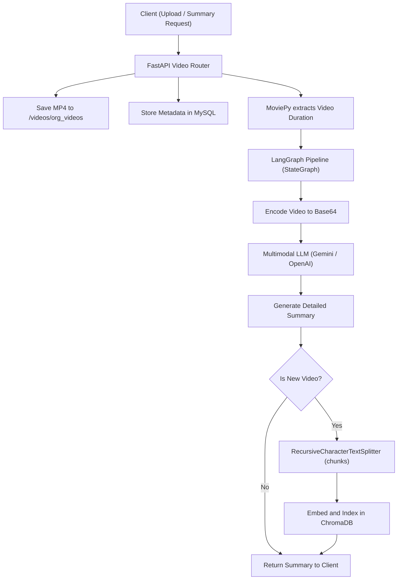
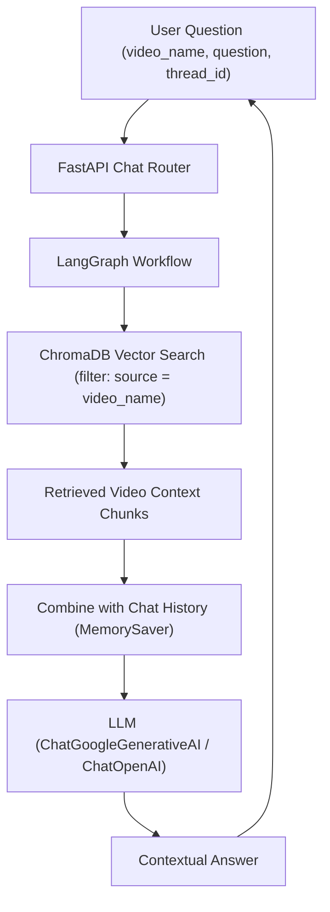

# AI Video Analyzer Backend

A robust, enterprise-ready FastAPI backend designed for AI-driven video analysis, intelligent summarization, temporal range clipping, and semantic conversational question-answering (RAG).

The application leverages **LangGraph** for workflow orchestration, **LangChain** with **ChromaDB** for vector storage, **SQLAlchemy** with **Alembic** and **MySQL** for relational persistence, **MoviePy** for video media processing, and multimodal LLMs (**Google Gemini** or **OpenAI GPT**).

---

## Table of Contents

- [Key Features](#key-features)
- [System Architecture](#system-architecture)
- [Tech Stack](#tech-stack)
- [Project Structure](#project-structure)
- [Prerequisites](#prerequisites)
- [Setup & Installation](#setup--installation)
  - [Method 1: Local Setup (Recommended for Dev)](#method-1-local-setup-recommended-for-dev)
  - [Method 2: Docker Setup](#method-2-docker-setup)
- [Environment Configuration (`.env`)](#environment-configuration-env)
- [Database Setup & Migrations (Alembic)](#database-setup--migrations-alembic)
- [API Documentation & Reference](#api-documentation--reference)
  - [Health Check](#health-check)
  - [Video Endpoints](#video-endpoints)
  - [Chat & Q&A Endpoints](#chat--qa-endpoints)
- [Troubleshooting & FAQs](#troubleshooting--faqs)

---

## Key Features

- **Multimodal Video Ingestion**: Accepts MP4 and various video formats, persists files locally, and tracks metadata in MySQL.
- **Automated Whole-Video Summarization**: Feeds raw video bytes directly into multimodal LLMs (Gemini / OpenAI) to generate comprehensive scene breakdowns, actions, and tone analysis.
- **Time-Range Segment Summaries**: Dynamically cuts subclips using MoviePy between `start_time` and `end_time` (in seconds) and generates targeted segment summaries with auto-cleanup of temporary files.
- **Customized Prompt Builder**: Generates tailored prompts based on target audience age rating, output language, bullet formatting, and safety/moderation filters (flagging harmful words or sensitive imagery).
- **Conversational RAG Q&A**: Employs LangGraph stateful memory and ChromaDB vector search to answer questions about any processed video with contextual recall across chat turns.
- **Media Streaming**: Provides high-throughput range streaming endpoints to serve uploaded MP4 videos directly to frontend HTML5 video players.
- **Clean Lifecycle Management**: Deleting a video cleans up all associated resources across the stack: MySQL metadata, ChromaDB embeddings, and the on-disk video file.

---

## System Architecture

### Video Ingestion & Summarization Pipeline



### Conversational Q&A / RAG Pipeline



---

## Tech Stack

| Component | Technology | Version | Description |
|-----------|------------|---------|-------------|
| **Framework** | FastAPI | 0.142.4 | Asynchronous Web API framework |
| **Server** | Uvicorn | 0.54.0 | ASGI web server implementation |
| **Orchestration** | LangGraph | 1.0.2 | Stateful multi-step graph-based AI agent orchestration |
| **LLM Framework** | LangChain Core / Classic | 1.0.x | AI chain utilities, document loading, text splitters |
| **Vector Database** | ChromaDB | 1.3.4 | Embedded vector store for semantic summary retrieval |
| **Relational Database** | MySQL | 8.0+ | Persistent storage for video metadata and attributes |
| **ORM** | SQLAlchemy | 2.1.4 | Object-Relational Mapping with scoped sessions |
| **DB Migrations** | Alembic | 1.20.0 | Versioned schema migration management |
| **Video Processing** | MoviePy | 2.2.1 | Video duration calculation and subclip cutting |
| **LLM Providers** | Google Gemini / OpenAI | - | Multimodal LLMs and text embeddings |

---

## Project Structure

```text
.
├── .env-copy                       # Sample environment configuration template
├── .env                            # Active environment configuration (git-ignored)
├── Dockerfile                      # Production Docker container definition
├── README.md                       # Complete backend documentation
├── alembic.ini                     # Alembic migration tool configuration
├── requirements.txt                # Python project dependencies
├── database.py                     # SQLAlchemy engine, scoped session & Base setup
├── logger_app.py                   # Centralized application logging configuration
├── main.py                         # FastAPI application entrypoint & middleware setup
│
├── alembic/                        # Database migration directory
│   ├── env.py                      # Migration runtime configuration (bound to database.py)
│   ├── script.py.mako              # Migration template script
│   └── versions/                   # Versioned migration revision files
│       ├── c3f506e72783_intial_setup.py
│       └── 14467b62f4a0_create_video_table.py
│
├── app/                            # Core application source package
│   ├── api/                        # API route controllers
│   │   ├── chat.py                 # Conversational Q&A / RAG endpoints
│   │   └── video.py                # Video upload, summary, listing, streaming, delete
│   ├── core/                       # Core configuration and settings
│   │   └── config.py               # Pydantic Settings loaded from .env
│   ├── schemas/                    # Pydantic request and response schemas
│   │   └── video_schemas.py        # VideoBase, SummaryRequest, QuestionRequest, etc.
│   ├── services/                   # Business logic layer
│   │   ├── utility.py              # MoviePy video processing and LangGraph bridging
│   │   ├── video.py                # High-level video domain service
│   │   └── ai_service/             # AI & LLM integration modules
│   │       ├── langgraph.py        # LangGraph StateGraph pipeline (video analysis & RAG)
│   │       ├── llm.py              # Provider factory (Google Gemini / OpenAI switch)
│   │       └── vector_store.py     # ChromaDB collection initialization and vector CRUD
│   └── sql/                        # Relational database layer
│       ├── crud/
│       │   └── video.py            # Video CRUD queries and paginated search filters
│       └── model/
│           └── video.py            # SQLAlchemy Video ORM entity
│
├── logs/                           # Auto-created runtime log directory
│   └── app.log                     # Rotating persistent log file
├── vector_db/                      # Chroma vector database storage directory
│   └── chroma_db/                  # SQLite & vector data files
└── videos/                         # Video file storage directory
    ├── org_videos/                 # Uploaded source video files
    └── temp_videos/                # Ephemeral subclips during range summarization
```

---

## Prerequisites

Before setting up the project, ensure you have the following installed:

1. **Python**: `3.11` or higher (`python3 --version`).
2. **FFmpeg**: Required by MoviePy for video header inspection, decoding, and subclip cutting.
   - **Ubuntu/Debian**:
     ```bash
     sudo apt update && sudo apt install -y ffmpeg
     ```
   - **macOS** (Homebrew):
     ```bash
     brew install ffmpeg
     ```
   - **Windows** (winget / Chocolatey):
     ```powershell
     winget install Gyan.FFmpeg
     ```
3. **MySQL Server**: `8.0` or higher (running locally or via Docker).
4. **LLM API Key**:
   - [Google AI Studio](https://aistudio.google.com/) API Key (for Gemini) **OR**
   - [OpenAI Platform](https://platform.openai.com/) API Key (for GPT-4o / GPT-4.1)

---

## Setup & Installation

### Method 1: Local Setup (Recommended for Dev)

#### Step 1: Clone the Repository

```bash
git clone <repository-url>
cd video-analyzer-with-ai
```

#### Step 2: Create and Activate a Virtual Environment

```bash
# Linux / macOS
python3 -m venv .venv
source .venv/bin/activate

# Windows (Command Prompt)
python -m venv .venv
.venv\Scripts\activate.bat

# Windows (PowerShell)
python -m venv .venv
.venv\Scripts\Activate.ps1
```

#### Step 3: Install Dependencies

```bash
pip install --upgrade pip
pip install -r requirements.txt
```

#### Step 4: Configure Environment Variables

Copy the provided sample configuration template to `.env`:

```bash
cp .env-copy .env
```

Open `.env` in your text editor and adjust the values (see [Environment Configuration](#environment-configuration-env) below).

#### Step 5: Create the MySQL Database

Connect to your MySQL server and create the database specified in `DATABASE_NAME` (e.g., `ai` or `video-analyzer`):

```bash
mysql -u root -p
```

```sql
CREATE DATABASE ai CHARACTER SET utf8mb4 COLLATE utf8mb4_unicode_ci;
EXIT;
```

#### Step 6: Run Database Migrations

Apply the existing Alembic migration scripts to initialize the database tables:

```bash
alembic upgrade head
```

Verify that the `videos` table has been created successfully.

#### Step 7: Launch the Application

Start the FastAPI application with auto-reload:

```bash
uvicorn main:app --reload --host 0.0.0.0 --port 8000
```

Alternative (using FastAPI CLI):

```bash
fastapi dev main.py --port 8000
```

#### Step 8: Verify the Server

- Open **Health Check**: [http://localhost:8000/](http://localhost:8000/)
- Open **Swagger Interactive Docs**: [http://localhost:8000/docs](http://localhost:8000/docs)
- Open **ReDoc Documentation**: [http://localhost:8000/redoc](http://localhost:8000/redoc)

---

### Method 2: Docker Setup

The project includes a multi-stage `Dockerfile` built on `python:3.11-slim`.

#### Step 1: Prepare `.env` for Docker

Ensure `.env` exists with valid configuration. When connecting to MySQL running on the host machine from inside a Docker container:
- **Linux**: Set `DATABASE_HOST="172.17.0.1"` (Docker default bridge IP) or host IP.
- **macOS / Windows**: Set `DATABASE_HOST="host.docker.internal"`.

#### Step 2: Build the Docker Image

```bash
docker build -t video-analyzer-backend:latest .
```

#### Step 3: Run Migrations Inside Container (or on host)

```bash
docker run --rm --env-file .env video-analyzer-backend:latest alembic upgrade head
```

#### Step 4: Run the Docker Container

Mount persistent volumes for `videos/`, `vector_db/`, and `logs/` to prevent data loss across restarts:

```bash
docker run -d \
  --name video-analyzer-app \
  -p 8000:8000 \
  --env-file .env \
  -v "$(pwd)/videos:/app/videos" \
  -v "$(pwd)/vector_db:/app/vector_db" \
  -v "$(pwd)/logs:/app/logs" \
  video-analyzer-backend:latest
```

View container logs:

```bash
docker logs -f video-analyzer-app
```

---

## Environment Configuration (`.env`)

The project uses `pydantic-settings` to load and validate variables on startup from `.env`.

### Configuration Parameters

| Variable | Type | Default / Example | Description |
|----------|------|-------------------|-------------|
| `LLM_PROVIDER` | `str` | `gemini` or `openai` | Active LLM backend provider |
| `LLM_MODEL_NAME` | `str` | `gemini-2.5-flash` or `gpt-4.1-mini` | Chat model identifier for video analysis & Q&A |
| `LLM_EMBEDDING_MODEL` | `str` | `models/embedding-001` or `text-embedding-ada-002` | Embedding model for semantic search in ChromaDB |
| `GOOGLE_API_KEY` | `str` | `AIzaSy...` | Required if `LLM_PROVIDER=gemini` |
| `OPENAI_API_KEY` | `str` | `sk-...` | Required if `LLM_PROVIDER=openai` |
| `VECTOR_DB_DIR_NAME` | `str` | `./vector_db/chroma_db` | Disk directory where ChromaDB persists embeddings |
| `VECTOR_DB_COLLECTION_NAME`| `str` | `video_summaries` | ChromaDB collection name |
| `DATABASE_CONNECTION` | `str` | `mysql+pymysql` | SQLAlchemy dialect and driver |
| `DATABASE_HOST` | `str` | `127.0.0.1` (or `172.17.0.1`) | MySQL database host address |
| `DATABASE_PORT` | `str` | `3306` | MySQL database port |
| `DATABASE_USER` | `str` | `root` | MySQL database username |
| `DATABASE_PASSWORD` | `str` | `root` | MySQL database password |
| `DATABASE_NAME` | `str` | `ai` | MySQL database name |
| `VIDEO_TEMP_DIR` | `str` | `./videos/temp_videos` | Temporary storage for MoviePy subclips |
| `VIDEO_ORG_DIR` | `str` | `./videos/org_videos` | Permanent storage for uploaded source videos |
| `LOG_FILE_DIR` | `str` | `./logs` | Directory where application log file (`app.log`) is written |

### Provider Configuration Examples

#### Option A: Google Gemini Configuration (Recommended Default)

```env
# LLM Config
LLM_PROVIDER=gemini
LLM_MODEL_NAME=gemini-2.5-flash
LLM_EMBEDDING_MODEL=models/embedding-001
GOOGLE_API_KEY=your_google_api_key_here
OPENAI_API_KEY=

# Vector DB Config
VECTOR_DB_DIR_NAME=./vector_db/chroma_db
VECTOR_DB_COLLECTION_NAME=video_summaries

# Database Config
DATABASE_CONNECTION=mysql+pymysql
DATABASE_HOST=127.0.0.1
DATABASE_PORT=3306
DATABASE_USER=root
DATABASE_PASSWORD=your_password
DATABASE_NAME=ai

# Directories Config
VIDEO_TEMP_DIR=./videos/temp_videos
VIDEO_ORG_DIR=./videos/org_videos
LOG_FILE_DIR=./logs
```

#### Option B: OpenAI Configuration

```env
# LLM Config
LLM_PROVIDER=openai
LLM_MODEL_NAME=gpt-4.1-mini
LLM_EMBEDDING_MODEL=text-embedding-ada-002
GOOGLE_API_KEY=
OPENAI_API_KEY=sk-your_openai_api_key_here

# Vector DB Config
VECTOR_DB_DIR_NAME=./vector_db/chroma_db
VECTOR_DB_COLLECTION_NAME=video_summaries

# Database Config
DATABASE_CONNECTION=mysql+pymysql
DATABASE_HOST=127.0.0.1
DATABASE_PORT=3306
DATABASE_USER=root
DATABASE_PASSWORD=your_password
DATABASE_NAME=ai

# Directories Config
VIDEO_TEMP_DIR=./videos/temp_videos
VIDEO_ORG_DIR=./videos/org_videos
LOG_FILE_DIR=./logs
```

---

## Database Setup & Migrations (Alembic)

Database schema changes are tracked and versioned using **Alembic**. Migration configurations in `alembic/env.py` directly reuse `engine` and `Base` from `database.py`.

### Database Schema: `videos` Table

The primary metadata table generated by migrations is `videos`:

| Column | Type | Constraints | Description |
|--------|------|-------------|-------------|
| `id` | `INT` | Primary Key, Auto Increment, Indexed | Unique identifier for video record |
| `video_name` | `VARCHAR(255)` | Not Null | Filename of the video saved on disk |
| `category` | `VARCHAR(255)` | Nullable | Content category (e.g. `tutorial`, `movie`, `meeting`) |
| `suitability`| `VARCHAR(255)` | Nullable | Audience rating (e.g. `All ages`, `PG-13`, `Adult`) |
| `video_type` | `VARCHAR(255)` | Nullable (Default: `mp4`) | File container format |
| `created_at` | `DATETIME` | Nullable, Default: `NOW()` | Timestamp when recorded |
| `updated_at` | `DATETIME` | Nullable, On Update: `NOW()`| Timestamp of last modification |

### Alembic Command Cheat Sheet

| Task | Command | Description |
|------|---------|-------------|
| **Apply All Migrations** | `alembic upgrade head` | Migrates schema up to the latest revision |
| **Roll Back One Revision** | `alembic downgrade -1` | Rolls back the most recent migration |
| **Roll Back to Base** | `alembic downgrade base` | Rolls back all migrations |
| **Check Current Revision** | `alembic current` | Shows the currently applied revision in the DB |
| **View Revision History** | `alembic history --verbose` | Displays the sequential list of revisions |
| **Auto-Generate Migration** | `alembic revision --autogenerate -m "message"` | Detects changes in `app/sql/model/` and creates a migration script |

#### Example: Modifying a Model & Generating a Migration

1. Update `app/sql/model/video.py` (e.g., add a new column).
2. Run autogenerate:
   ```bash
   alembic revision --autogenerate -m "Add description column to videos"
   ```
3. Inspect the newly generated file in `alembic/versions/`.
4. Apply the migration:
   ```bash
   alembic upgrade head
   ```

---

## API Documentation & Reference

Once running, interactive documentation is available at:
- Swagger UI: `http://localhost:8000/docs`
- ReDoc: `http://localhost:8000/redoc`

### Health Check

#### `GET /`
Returns service status, application name, and version.

**Response (`200 OK`)**:
```json
{
  "status": "healthy",
  "service": "Video Analyzer with AI API",
  "version": "1.0.0"
}
```

---

### Video Endpoints

#### 1. Upload Video
`POST /api/video/upload`

Uploads an MP4 video, saves it to `VIDEO_ORG_DIR`, registers metadata in MySQL, inspects duration via MoviePy, and optionally generates and indexes an initial summary.

- **Content-Type**: `multipart/form-data`
- **Parameters**:
  - `file` (File, required): The video file binary.
  - `video_type` (Form string, optional, default `"mp4"`): Video extension or format.
  - `generate_initial_summary` (Form boolean, optional, default `false`): If `true`, immediately runs LLM summarization and stores vector embeddings in ChromaDB.

**Example `curl`**:
```bash
curl -X POST "http://localhost:8000/api/video/upload" \
  -F "file=@sample_presentation.mp4" \
  -F "video_type=mp4" \
  -F "generate_initial_summary=true"
```

**Response (`200 OK`)**:
```json
{
  "message": "Video uploaded successfully",
  "video": {
    "id": 1,
    "video_name": "sample_presentation.mp4",
    "video_type": "mp4",
    "duration": 185,
    "duration_formatted": "3:05",
    "created_at": "2026-10-21T13:30:00"
  },
  "summary": "This video is a presentation covering..."
}
```

---

#### 2. List Videos (Paginated & Filtered)
`GET /api/video/list`

Retrieves a paginated list of videos from the database enriched with dynamic on-disk duration calculations.

- **Query Parameters**:
  - `page` (int, optional, default `1`): Current page number.
  - `limit` (int, optional, default `20`, max `100`): Items per page.
  - `filter` (string, optional): Case-insensitive fuzzy search matching against `video_name`, `video_type`, `category`, and `suitability`.

**Example `curl`**:
```bash
curl -X GET "http://localhost:8000/api/video/list?page=1&limit=10&filter=presentation"
```

**Response (`200 OK`)**:
```json
{
  "total": 1,
  "videos": [
    {
      "id": 1,
      "video_name": "sample_presentation.mp4",
      "category": null,
      "suitability": null,
      "video_type": "mp4",
      "duration": 185,
      "duration_formatted": "3:05",
      "created_at": "2026-10-21T13:30:00"
    }
  ],
  "page": 1,
  "limit": 10
}
```

---

#### 3. Get Video by ID
`GET /api/video/get/{video_id}`

Fetches single video metadata by database primary key.

**Example `curl`**:
```bash
curl -X GET "http://localhost:8000/api/video/get/1"
```

---

#### 4. Stream Video File
`GET /api/video/stream/{video_name}`

Streams the video file from disk as `video/mp4` for playback in browser `<video>` tags.

**Example `curl`**:
```bash
curl -X GET "http://localhost:8000/api/video/stream/sample_presentation.mp4" -O
```

---

#### 5. Generate Full Video Summary
`POST /api/video/summary`

Generates an AI summary for an existing on-disk video.

- **Content-Type**: `application/json`
- **Request Body**:
  ```json
  {
    "video_name": "sample_presentation.mp4",
    "prompt": "Highlight key takeaways and action items in bullet points.",
    "is_new_video": false
  }
  ```

**Response (`200 OK`)**:
```json
{
  "video_name": "sample_presentation.mp4",
  "summary": "1. Key Takeaway: The speaker outlined the quarterly milestones..."
}
```

---

#### 6. Generate Time-Range Summary (Subclip)
`POST /api/video/range-summary`

Cuts a temporary subclip between `start_time` and `end_time` (in seconds) and generates a focused summary for that segment. The temporary subclip is automatically deleted after processing.

- **Content-Type**: `application/json`
- **Request Body**:
  ```json
  {
    "video_name": "sample_presentation.mp4",
    "start_time": 10,
    "end_time": 60,
    "prompt": "Summarize what is discussed in this segment."
  }
  ```

**Response (`200 OK`)**:
```json
{
  "video_name": "sample_presentation.mp4",
  "summary": "During this segment, the introduction to the architecture was presented..."
}
```

---

#### 7. Build Custom Prompt Helper
`POST /api/video/custom-prompt`

Utility endpoint that compiles UI form selections into a structured prompt instruction string.

- **Content-Type**: `application/json`
- **Request Body**:
  ```json
  {
    "summary_type": "Executive summary",
    "summary_duration": 2,
    "summary_bullet": true,
    "detect_harmful_words": true,
    "detect_harmful_pictures": true,
    "age": 13,
    "summary_language": "English"
  }
  ```

**Response (`200 OK`)**:
```json
{
  "prompt": "Generate a executive summary of the given video. The summary should be in 2 minute(s). Write the summary in English language. Evaluate whether the video content (audio & visuals) is appropriate for viewers under 13 years old. Present the summary in well-structured bullet points, covering aspects such as video language, category (movie, song, cartoon), and tone. Identify and highlight any harmful, offensive, or inappropriate words in the transcript. Analyze and mention if the video contains harmful, violent, or inappropriate visuals."
}
```

---

#### 8. Delete Video
`DELETE /api/video/{video_id}`

Deletes all video assets across the entire system:
1. Purges vector embeddings tagged with `source: video_name` from ChromaDB.
2. Deletes the metadata row from MySQL.
3. Removes the physical file from `videos/org_videos/`.

**Example `curl`**:
```bash
curl -X DELETE "http://localhost:8000/api/video/1"
```

**Response (`200 OK`)**:
```json
{
  "message": "Video 'sample_presentation.mp4' deleted successfully",
  "id": 1
}
```

---

### Chat & Q&A Endpoints

#### Ask a Question About Video Content (RAG)
`POST /api/chat/ask`

Answers conversational questions about an uploaded video using ChromaDB semantic retrieval combined with LangGraph thread memory.

- **Content-Type**: `application/json`
- **Request Body**:
  ```json
  {
    "video_name": "sample_presentation.mp4",
    "question": "What tools or frameworks were mentioned in the presentation?",
    "thread_id": "session-101"
  }
  ```
  *(Note: If `thread_id` is omitted, the endpoint defaults to `video_name` to maintain conversational memory for that video).*

**Response (`200 OK`)**:
```json
{
  "question": "What tools or frameworks were mentioned in the presentation?",
  "answer": "The presentation mentioned FastAPI, LangGraph, ChromaDB, and MySQL as core architectural components.",
  "thread_id": "session-101"
}
```

---

## Troubleshooting & FAQs

### 1. `MoviePy / FFmpeg: FileNotFoundError or Imageio / FFmpeg error`
- **Cause**: FFmpeg is not installed or not available in the system `PATH`.
- **Solution**: Install FFmpeg via system package manager:
  - Ubuntu/Debian: `sudo apt update && sudo apt install -y ffmpeg`
  - macOS: `brew install ffmpeg`
  - Windows: `winget install Gyan.FFmpeg`
  Verify with `ffmpeg -version`.

### 2. `MySQL: Can't connect to MySQL server / Access denied`
- **Cause**: Incorrect database credentials or MySQL is not running.
- **Solution**:
  - Verify MySQL is active: `sudo systemctl status mysql` (Linux) or check your MySQL service.
  - Verify credentials in `.env` (`DATABASE_USER`, `DATABASE_PASSWORD`, `DATABASE_HOST`, `DATABASE_PORT`).
  - Ensure the target database exists: `CREATE DATABASE ai;`.

### 3. `Alembic: Can't locate revision identified by 'c3f506e72783'`
- **Cause**: The database contains a dirty `alembic_version` table pointing to an unknown revision.
- **Solution**: Check current version:
  ```bash
  alembic current
  ```
  If working on a fresh local setup, drop and recreate the database:
  ```sql
  DROP DATABASE ai;
  CREATE DATABASE ai;
  ```
  Then re-run:
  ```bash
  alembic upgrade head
  ```

### 4. `Google Gemini: 400 API key not valid / RESOURCE_EXHAUSTED`
- **Cause**: Missing, invalid, or quota-exceeded Google API key.
- **Solution**:
  - Generate an API key in [Google AI Studio](https://aistudio.google.com/).
  - Paste it into `GOOGLE_API_KEY` in `.env`.
  - Ensure `LLM_PROVIDER=gemini` and `LLM_MODEL_NAME=gemini-2.5-flash`.

### 5. `Docker: Can't connect to MySQL running on localhost`
- **Cause**: Inside a Docker container, `localhost` refers to the container itself, not the host machine.
- **Solution**:
  - On Linux: Set `DATABASE_HOST=172.17.0.1` (or your host IP) in `.env`.
  - On macOS/Windows: Set `DATABASE_HOST=host.docker.internal` in `.env`.

---

## License

This project is licensed under the terms of the license included within the repository (or proprietary if private). Please consult repository owners for commercial usage.
